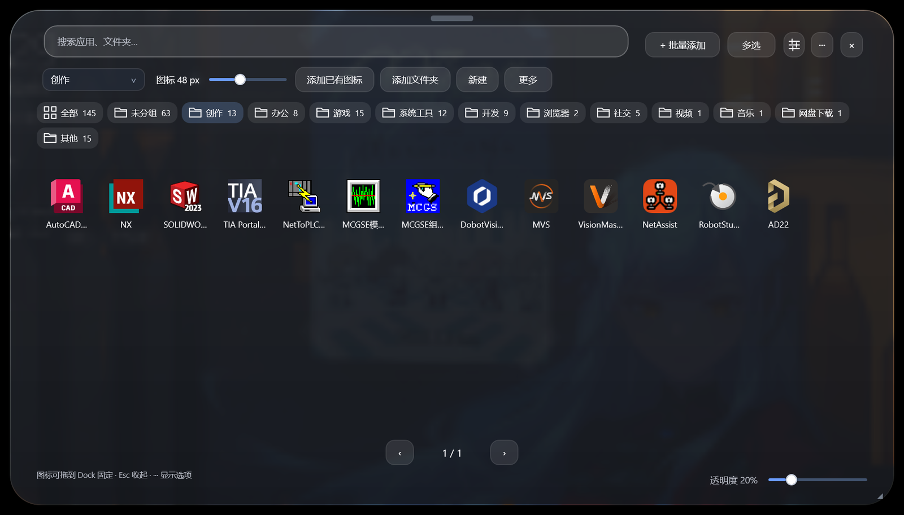

# GlassBoard 使用教程

> 适用版本：**v0.9.17 测试版**
> 适用系统：Windows 10 / 11（64 位）
> 最后更新：2026-11-01
>
> 这份教程写给**不熟悉电脑**的用户。全文没有命令、没有配置代码，每一步都写清楚"点哪里"。
> 遇到看不懂的步骤，先看第 17 章「出问题怎么反馈」，把截图发过去比自己试更快。

---

## 目录

| 想做什么 | 看第几章 |
| --- | --- |
| 先装上、能打开 | 1 |
| 装好了，第一次该怎么配 | 2 |
| 搞不清界面上都是什么 | 3 |
| 整理程序、加图标、分组 | 4 – 6 |
| 调 Dock 的样子和行为 | 7 |
| 让桌面更干净 | 8 |
| 换成玻璃质感、调透明度 | 9 |
| 摆弄桌面时钟 | 10 |
| 一键打开一组程序 | 11 |
| 备份、换电脑 | 12 |
| 开机启动、更新、卸载 | 13 |
| 界面突然不见了 | 16 |

---

## 1. 装好并启动

### 1.1 解压到新文件夹

右键下载到的 `GlassBoard_v0.9.17_User.zip` → **全部解压缩** → 选一个空文件夹，比如 `D:\GlassBoard`。

> ⚠️ 必须**整个文件夹**一起解压。
> 只把 `GlassBoard.exe` 单独拖出来，双击会没反应——程序需要同目录的 `data\`、`src\`、`Interop.UIAutomationClient.dll` 等文件。

### 1.2 启动

进入解压出来的文件夹，双击：

- `GlassBoard.exe`（推荐）
- 或 `Start.cmd`（会先检查文件是否齐全，缺文件时会用中文提示）

看到任务栏右下角出现一个托盘图标、屏幕边缘浮出一条图标栏，就是启动成功了。

### 1.3 出现"已保护你的电脑"怎么办

Windows 会弹一个蓝色窗口，标题是「Windows 已保护你的电脑」。

点 **更多信息** → 右下角出现 **仍要运行** → 点它。

这不是病毒提示，是因为程序**没有购买数字签名**（签名证书每年要花钱）。每次换新版本，第一次运行可能都会问一次。

### 1.4 杀毒软件报毒

大概率会报，原因同样是「没有数字签名」+「会读取当前运行了哪些程序」。

处理：在杀毒软件里把它加入**信任区 / 白名单**。
不要为了装它把杀毒软件整个关掉。

### 1.5 第一次打开会看到什么

| 位置 | 是什么 |
| --- | --- |
| 屏幕边缘 | **Dock**：一条会自动浮现的图标栏 |
| 任务栏右下角托盘 | 一个小图标，右键是主菜单 |
| 桌面左上角 | **时钟组件**（如果默认开启了） |

### 1.6 正确的退出方式

**不要**直接关任务栏里的图标，也不要结束进程。

正确做法：**右键托盘图标 →「退出 GlassBoard」**。

这样配置会完整写盘，下次打开还在。

---

## 2. 第一次打开，先做三件事

### 2.1 先备份一份（最重要）

**设置 → 通用 → 完整备份与恢复 → 导出完整备份**

会生成一个 `.gbbackup` 文件，存到你知道的位置（比如桌面）。
以后配置乱了、换电脑、重装系统，用它一键还原。

> 现在还是测试版，这一步别省。

### 2.2 把最常用的三个程序拖进 Dock

从桌面或开始菜单，把图标**按住拖到 Dock 上**松手，就固定住了。

先放三个最常用的即可，用顺手了再慢慢加。

### 2.3 决定要不要开机自启

**设置 → 桌面组件 → 开机自启动（包括 Dock 与已启用的组件）**

- 想让它在开机后自动出现 → 勾上
- 只是先试用 → 不勾，以后随时能改

---

## 3. 认识界面：四个区域

### 3.1 Dock

屏幕边缘的一条悬浮栏，鼠标靠近会自动浮出来。

从左到右通常是：

1. **九宫格按钮** —— 打开大面板
2. 分隔线
3. 系统图标（此电脑、电源等，可在设置里关）
4. 你固定的程序
5. **齿轮** —— 打开设置

### 3.2 大面板

点 Dock 上**最左边的九宫格按钮**打开。

这是一屏看到所有程序的地方，也是整理图标的主要地方。



### 3.3 桌面组件

默认是**时钟和天气**，可以摆在桌面任意位置，独立拖动。

### 3.4 托盘图标

任务栏右下角的小图标（可能被折叠进 `^` 里）。**右键它**，几乎所有功能都在那个菜单里：

| 菜单项 | 用途 |
| --- | --- |
| 打开应用面板 | 同 Dock 的九宫格按钮 |
| 添加软件 | 选一个 exe 加进来 |
| 导入开始菜单应用 | 一次把装机软件全扫进来 |
| 设置 | 打开设置窗口 |
| 隐藏 / 显示任务栏 | 让系统任务栏消失或回来 |
| 隐藏 / 显示桌面图标 | 让桌面图标消失或回来 |
| 恢复任务栏与桌面图标 | **找不到任务栏或桌面图标时点这个** |
| Windows 任务栏自动隐藏 | 切换系统任务栏的自动隐藏 |
| 组件布局 | 调整组件摆放 |
| 恢复并开启全部组件 | **组件不见了时点这个** |
| 工作区管理 | 管理「一键打开一组程序」 |
| 外观方案 | 保存 / 切换皮肤 |
| 打开配置文件夹 | 看日志、备份、配置文件 |
| 退出 GlassBoard | 正确退出 |

---

## 4. 大面板详解

### 4.1 打开与收起

- 打开：点 Dock 最左边的九宫格按钮
- 收起：按 **Esc**，或点面板右上角的 ×

### 4.2 搜索

面板顶部就是搜索框，直接打字。

支持搜**程序名**和**文件夹名**，不用记它被分在哪个组。

### 4.3 分组栏

搜索框下面那一排就是分组，括号里的数字是这个组里有多少个入口。

```
全部 145 | 未分组 63 | 创作 13 | 办公 8 | 游戏 15 | ...
```

- 点分组名 → 只显示该组
- 「未分组」= 还没归类的
- 「其他」= 分组被删后暂时无处可去的

### 4.4 图标大小、面板尺寸、透明度

| 想改什么 | 在哪里 |
| --- | --- |
| 图标大小 | 面板上方「图标 48 px」那条滑杆 |
| 面板尺寸 | 设置 → 面板与主题 → 大面板尺寸 |
| 面板透明度 | 设置 → 面板与主题 → 大面板透明度；或面板右下角滑杆 |

> 透明度**两个方向相反**，容易搞混：
> - 设置里「大面板透明度 20%」= 数字越大越透
> - 右下角「透明度 20%」同理，**想看得更清楚就调小**

### 4.5 批量整理

- 点面板上方 **多选** → 图标进入选中状态
- 勾选后可以**跨页勾选**（翻到下一页继续勾，已勾的不会丢）
- 点「移除」→ 一次删掉多个入口

### 4.6 删错了怎么办

按 **Ctrl+Z** 撤销。

面板会提示「撤销：xxx · Ctrl+Z」，告诉你上一步做了什么。

### 4.7 右键图标

右键任意图标，常用的是：

- **移动到分组**：把它归到别的组
- **恢复原图标**：图标变成白纸时点这个
- **从面板移除**：只是不显示，不删你的文件

### 4.8 底部信息栏

面板底部写着：

> 图标可拖到 Dock 固定 · Esc 收起 · … 显示选项

「… 显示选项」里可以控制隐藏搜索框、隐藏分组栏、隐藏文件夹等内容，想要极简面板就去那里关。

### 4.9 打开面板时定位到哪个分组

**设置 → 面板与主题 → 打开面板时定位到**

可以固定每次打开都停在某个组（比如「创作」），省得每次手动切。
分组被删掉后，会自动回退到「全部」。

---

## 5. 添加程序、文件、文件夹

### 5.1 方法一：直接拖

把桌面快捷方式、开始菜单里的程序、文件夹，**拖进大面板**，松手即添加。

### 5.2 方法二：批量添加

面板上方 **+ 批量添加** → 选多个 exe 一起加。

### 5.3 方法三：导入开始菜单

托盘右键 →「导入开始菜单应用」，会把开始菜单里能扫到的程序一次列出来，勾选后批量导入。

> 程序装得多时，这是最快的一次性配置方法。

### 5.4 文件夹入口 vs 扫描文件夹

| 类型 | 效果 |
| --- | --- |
| **添加文件夹**（作为入口） | 面板里多一个文件夹图标，点开是资源管理器 |
| **扫描文件夹** | 把这个文件夹里的所有程序都变成面板里的图标 |

### 5.5 改名字和图标

右键图标 → 可以改显示名称、换自定义图标。
图标突然变白纸时，用「恢复原图标」。

---

## 6. 分组

### 6.1 手动建组

面板上方 **新建** → 输入组名 → 之后把图标「移动到分组」即可。

### 6.2 自动分组

程序会按规则自动把新导入的程序归到合适的组（比如开发工具、社交、游戏等）。

自动分完不满意，手动改就行——手动归类会覆盖自动结果。

### 6.3 删除分组会怎样

- 组里的入口**不会丢**，会落到「其他」组
- 如果「打开面板时定位到」正好设的是这个组，会自动回退到「全部」

---

## 7. Dock 详解

### 7.1 固定与移除

- **固定**：把图标拖到 Dock 上
- **移除**：右键图标 → 移除（只是从 Dock 拿掉，不删文件）

### 7.2 排序

- 按住图标左右拖
- 右键 →「向前移动」/「向后移动」微调一格

### 7.3 位置与对齐

右键 Dock 空白处：

| 菜单项 | 作用 |
| --- | --- |
| 允许自由拖动 Dock | 打开后可以把 Dock 拖到屏幕任意位置 |
| 弹簧弹出效果 | 鼠标划过图标时的放大回弹 |
| Dock 自动隐藏 | 平时藏起来，鼠标碰到屏幕边缘才出来 |
| 显示 Dock 设置图标 | 控制最右边齿轮是否显示 |

其他位置参数（贴哪条边、离边缘多少像素、图标大小、悬停放大倍数）在 **设置 → Dock DIY** 里。

### 7.4 滚轮切两页

Dock 有**两页**，用滚轮切换：

| 方向 | 切到哪一页 | 默认 |
| --- | --- | --- |
| 滚轮向上 | 常用软件 | 你固定的那些 |
| 滚轮向下 | 正在运行 | 当前开着的窗口 |

这两个方向都能在右键菜单里互换。

### 7.5 运行状态标记

已经在运行的程序，图标下面会有一个小圆点。
点一下图标会**切到那个窗口**，而不是再开一个。

### 7.6 系统图标

**设置 → Dock DIY** 里可以开关：

- 显示此电脑
- 显示电源快捷菜单

---

## 8. 让桌面更干净

### 8.1 隐藏系统任务栏

托盘右键 →「隐藏 / 显示任务栏」。
也可以让它自动隐藏：托盘右键 →「Windows 任务栏自动隐藏」。

### 8.2 隐藏桌面图标

托盘右键 →「隐藏 / 显示桌面图标」。

> 文件**没有删**，只是不显示。再点一次就回来。

### 8.3 紧急恢复

万一任务栏和桌面图标都没了、又找不到托盘图标：

双击程序文件夹里的 **`RestoreDesktop.cmd`**。

---

## 9. 外观：玻璃与主题

### 9.1 浅色玻璃

**设置 → 面板与主题 → 使用浅色玻璃**

一个勾选框切换深浅两套。

### 9.2 玻璃材质

**设置 → 面板与主题** 里可调：

| 项目 | 说明 |
| --- | --- |
| 材质种类 | 不同质感的玻璃底 |
| 色调 | 底色偏冷还是偏暖 |
| 光泽 | 高光强度 |
| 纹理 | 颗粒感 |
| 阴影 | 窗口投影 |
| 玻璃模糊 | 背景虚化程度 |
| 边缘高光 | 边框那一圈亮线 |

> 只改玻璃背景，图标和文字始终保持清晰。

### 9.3 外观方案

调好一套想留着：

**设置 → 面板与主题**（或托盘右键 →「外观方案」）→ 保存当前方案。

- 之后可以随时切回来
- 也能**导出成文件**分享给别人，对方导入即可
- 方案里包含：浅色/深色、面板尺寸、图标大小与间距、透明度、Dock 间距、材质、位置

---

## 10. 桌面组件（时钟）

### 10.1 开启与关闭

**设置 → 桌面组件** → 勾选要显示的组件。

也可以托盘右键 →「组件布局」单独开关。

### 10.2 移动与调尺寸

- 移动：按住组件空白处拖动
- 调尺寸：拖右下角
- 吸附：拖动结束时会自动对齐桌面中线、相邻组件的边缘和中心线（阈值 10 像素），对不齐就保持自由位置

### 10.3 锁定位置

右键组件 →「锁定组件位置和尺寸」。

锁定后不会被误拖走。想恢复大小用「恢复自动尺寸」。

### 10.4 无框模式

右键组件 →「无框模式」。

去掉背景板和边框，只留文字，适合配壁纸软件。想恢复用「恢复组件边框」。

### 10.5 文字颜色、字体与样式

右键组件 →「外观 DIY · 文字颜色 / 无框 / 样式」

| 可调 | 说明 |
| --- | --- |
| 文字颜色 | 包括预设和自定义 |
| 文字阴影 | 深色壁纸上更容易看清 |
| 时钟样式 | **共 13 种**，菜单里直接切 |
| 字体 | 可换字体 |
| 日期与 12/24 小时制 | 单独开关 |

> 文字颜色调成和壁纸一样，会"看不见"。右键 →「恢复默认」即可。


### 10.6 组件不见了怎么找回

按顺序试：

1. 托盘右键 →「恢复并开启全部组件」
2. 托盘右键 →「组件布局」，看是不是被拖到屏幕外了
3. **设置 → 桌面组件** → 重新勾选
4. 双击 **`RecoverWidgets.cmd`**

---

## 11. 工作区：一键打开一组程序

### 11.1 适用场景

「写东西时要开编辑器 + 浏览器 + 项目文件夹」——每次都一个个点很烦，存成一个工作区，下次一键全开。

### 11.2 建立工作区

托盘右键 →「工作区管理」→ 输入名字 → 把要一起打开的程序、素材文件夹、项目文件加进去 → 保存。

### 11.3 日常使用

托盘右键 →「打开工作区 · 名字」，一次全部打开。

---

## 12. 备份、换电脑、找回旧配置

### 12.1 什么时候该备份

- 刚配置满意时
- 准备升级版本前
- 换电脑前

### 12.2 导出

**设置 → 通用 → 完整备份与恢复 → 导出完整备份**

生成 `GlassBoard_完整备份_年月日时分.gbbackup`。

备份内容：布局、分组、组件、外观方案、自定义图标。
**不含**程序文件本身，也不含开机启动设置（按当前电脑走）。

### 12.3 恢复

同一位置点「恢复完整备份」，选那个 `.gbbackup` 文件。

> 恢复前，当前配置会**自动另存一份**，覆盖错了还能找回。

### 12.4 换电脑的标准顺序

1. 旧电脑：导出完整备份
2. 把 `.gbbackup` 拷到新电脑
3. 新电脑：解压程序、启动
4. 设置 → 通用 → 完整备份与恢复 → 恢复完整备份
5. 重新决定开机自启

### 12.5 配置存在哪

托盘右键 →「打开配置文件夹」，路径是：

```
%LOCALAPPDATA%\GlassBoard\
```

里面重要的文件：

| 文件 | 内容 |
| --- | --- |
| `layout.json` | 主配置：布局、分组、图标 |
| `layout.json.previous` / `.last-good` | 自动保留的上一个 / 最近可用版本 |
| `session.log` | 运行记录 |
| `update.log` | 最近一次检查更新的逐条结果 |
| `error.log` | 出错记录 |

---

## 13. 开机启动、在线更新、卸载

### 13.1 开机启动

**设置 → 桌面组件 → 开机自启动（包括 Dock 与已启用的组件）**

关掉后不会留后台残留。

### 13.2 检查更新

**设置 → 通用 → 软件更新 → 立即检查**

- 有新版本会显示版本号和大小
- 点「下载并更新」→ 程序自己退出、替换、重启
- 更新只替换程序文件，配置保留（替换前自动备份）

### 13.3 检查更新失败

按顺序试：

1. 同一页把「使用 Windows 系统代理」切成「直接连接」再试
2. 反过来：如果本来就是直接连接，换回系统代理
3. 托盘右键 →「打开配置文件夹」→ 看 `update.log`，里面逐条记录每条线路的结果

### 13.4 彻底卸载

1. **设置 → 桌面组件** → 关掉「开机自启动」← **必须先做**
2. 托盘右键 →「退出 GlassBoard」
3. 删除整个程序文件夹
4. 想连配置一起清：托盘右键 →「打开配置文件夹」→ 删除整个 `GlassBoard` 文件夹

> 第 1 步不能省。直接删文件夹会留下一个开机任务。

---

## 14. 全屏时自动让位

看视频、玩游戏（全屏）、演示 PPT 时：

- Dock、大面板、组件会自动隐藏
- 退出全屏后 1～2 秒自动回来

这是自动的，不需要开关。

> 如果全屏结束 Dock 没回来，等 3 秒；还不回来就用托盘右键「恢复并开启全部组件」。

---

## 15. 内存占用

### 15.1 为什么任务管理器里数字忽高忽低

程序闲置 5 分钟会自动回收内存。实测：

| 场景 | 内存（工作集） |
| --- | --- |
| 刚启动 | 约 120MB |
| 闲置几分钟后 | **5–10MB** |
| 大面板刚打开过 | 会到 200MB 左右，关掉后回落 |

### 15.2 大面板会吃内存吗

大面板是**分页渲染**的：只渲染当前这一页的图标，不是一次性把全部图标都画出来。

### 15.3 想自己看

双击 **`CheckMemory.cmd`**，会打印当前占用。

---

## 16. 界面不见了：按顺序恢复

### 16.1 Dock 不见了

1. 鼠标沿屏幕四条边扫一圈（可能是自动隐藏）
2. 托盘右键 →「恢复并开启全部组件」
3. 双击 `RecoverWidgets.cmd`
4. 还不行 → 重启程序

### 16.2 大面板打不开

1. 托盘右键 →「打开应用面板」试试
2. 双击 `RecoverWidgets.cmd`
3. 仍不行 → 退出程序重新启动

### 16.3 某个组件不见了

1. 托盘右键 →「恢复并开启全部组件」
2. 设置 → 桌面组件 → 重新勾选
3. 双击 `RecoverWidgets.cmd`

### 16.4 文字看不见了

组件还在，只是颜色和壁纸一样。

右键组件 →「外观 DIY」→ 恢复默认颜色，或先打开「文字阴影」。

### 16.5 任务栏 / 桌面图标不见了

双击 **`RestoreDesktop.cmd`**，或托盘右键 →「恢复任务栏与桌面图标」。

### 16.6 所有位置全乱了

**设置 → 通用 → 完整备份与恢复 → 恢复完整备份**，选最近一份备份。

没备份过的话：托盘右键 →「组件布局」→ 找「恢复默认」类的按钮。

---

## 17. 出问题怎么反馈

1. 双击程序文件夹里的 **`CollectDiagnostics.cmd`**
2. 桌面会出现 `GlassBoard_Diagnostics_年月日_时分秒.zip`
3. 到 https://github.com/xinxiao1011/GlassBoard/issues 新建一条，把 zip 拖进去
4. 再补三句话：
   - 系统是 Win10 还是 Win11，有没有多显示器
   - 出问题前你做了什么
   - 现象是什么（能截图最好）

> zip 里只有程序自己的运行日志和你的配置，不含账号密码，也不含你其他文件的内容。

---

## 18. 术语对照

| 词 | 意思 |
| --- | --- |
| **Dock** | 屏幕边缘那条会自动浮现的图标栏 |
| **大面板** | 点 Dock 最左按钮打开的全屏程序列表 |
| **入口 / 图标** | 面板里的一个程序、文件或文件夹 |
| **分组** | 面板里对入口的分组，像文件夹 |
| **组件** | 摆在桌面上的小挂件（时钟） |
| **无框模式** | 去掉组件背景板，只显示文字 |
| **工作区** | 一组程序 + 文件夹的集合，可以一键全开 |
| **外观方案** | 一套保存下来的界面皮肤 |
| **完整备份** | 一个 `.gbbackup` 文件，装着你的全部配置 |
| **托盘图标** | 任务栏右下角的小图标，右键是主菜单 |
| **全屏让位** | 全屏程序运行时自动隐藏，退出后自动恢复 |

---

## 附：随程序附带的三个急救工具

| 文件 | 什么时候双击它 |
| --- | --- |
| `RecoverWidgets.cmd` | 组件不见了、位置乱了 |
| `RestoreDesktop.cmd` | 任务栏或桌面图标被隐藏了 |
| `CollectDiagnostics.cmd` | 要反馈问题，打包日志到桌面 |

另外两个查状态的：

| 文件 | 作用 |
| --- | --- |
| `CheckMemory.cmd` | 打印当前内存占用 |
| `CheckWindows.cmd` | 打印系统环境信息 |
